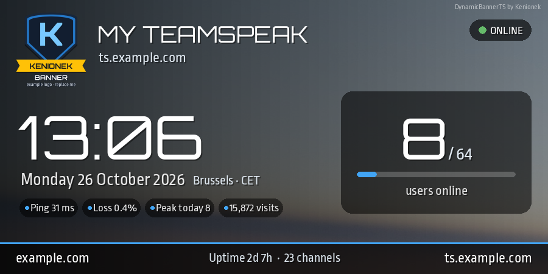
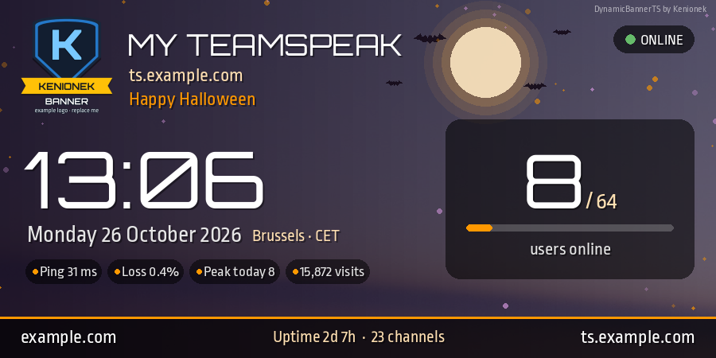
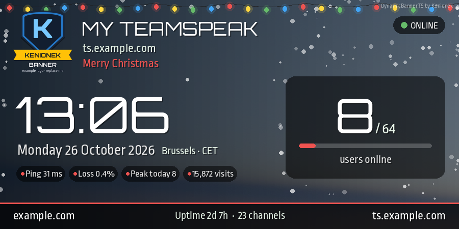
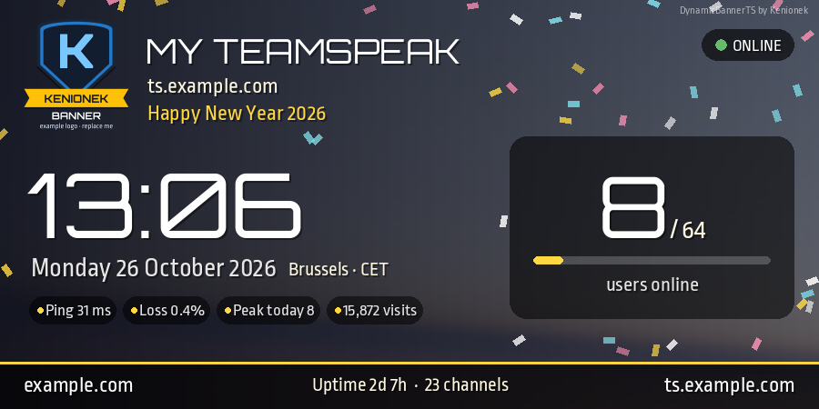
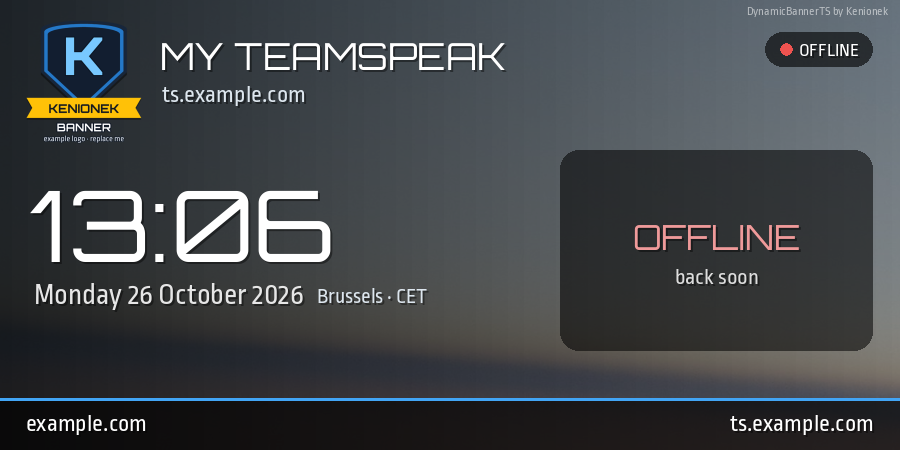
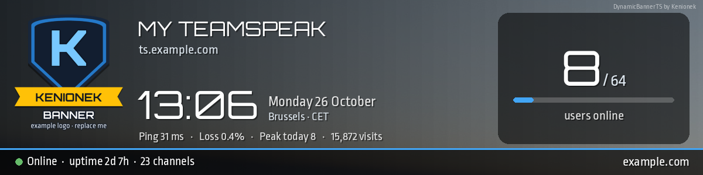
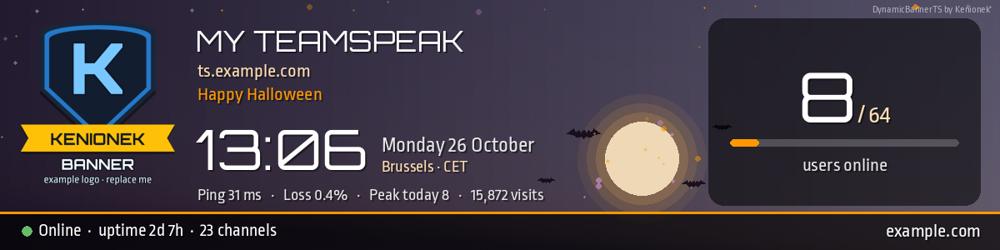

# DynamicBannerTS

A live, good-looking banner for your **TeamSpeak 3** server. Use it as your TeamSpeak host banner or put it on your website.



It shows:
- live users with a fill bar, slots, channels and uptime;
- ping, packet loss, today's peak and total visits;
- a clock with the date and time zone;
- your logo, title and address;
- an online/offline status;
- seasonal themes that switch by themselves.

## Features

- **Two layouts**
  - `banner.php`: 900 × 450 classic banner (TeamSpeak host banner)
  - `banner-wide.php`: 1200 × 300 wide banner (website header or sidebar)
- **Four seasonal themes, switched automatically:** default, Halloween, Christmas and New Year. The New Year year updates itself.
- **No frameworks.** It talks to ServerQuery directly and only needs PHP with GD.
- **Light on your server.** Stats are cached for 30 seconds and the image for 1 minute, so a thousand viewers still mean one query login every 30 seconds. TeamSpeak won't flood-ban you.
- **Safe by default.** Your query password lives in its own file that is never committed and is blocked from the web. Errors are logged, never shown in the image or the page.

| | |
|---|---|
|  |  |
|  |  |




## Requirements

- PHP **8.0 or newer** with the **GD** extension and FreeType support. Check with `php -m | grep -i gd`.
- A web server (Apache, nginx, Caddy, ...).
- A ServerQuery login for your TeamSpeak 3 server.

## Installation

1. Copy this folder to your web server, for example as `/var/www/html/banner/`.
2. Copy `config.example.php` to **`config.php`** and set your title, address, website, time zone and colours.
3. Copy `secret.example.php` to **`secret.php`** and fill in your ServerQuery host, ports, username and password.
4. Replace `assets/logo.png` with your own logo (a PNG with transparency) and, if you like, `assets/background.jpg` with your own photo.
5. Open `https://your-site/banner/banner.php`. You should see your banner.
6. In TeamSpeak, open **Virtual Server → Edit → Host → Host Banner**. Set the banner URL to `https://your-site/banner/banner.php`, set the resize mode to *scale*, and set the reload interval to 60 seconds.

On a website:

```html

```

## Themes

The theme follows the date: Halloween from Oct 25 to Nov 1, Christmas from Dec 1 to 30, and New Year from Dec 31 to Jan 2. Set `'seasonal_themes' => false` in `config.php` to always use the default look in your own `accent` colour.

To preview a theme, add `?theme=halloween`, `?theme=christmas`, `?theme=newyear` or `?theme=default` to the URL.

Want more themes, such as Easter or your server's birthday? Open `src/Themes.php` and:
1. add the name to `NAMES`;
2. add the dates to `pick()`;
3. add its colours and text line to `style()`;
4. optionally add decorations to `decorate()`.

## Security tips

- **Use a separate query login** instead of `serveradmin` where you can, with only the rights the banner needs (`login`, `use`, `serverinfo`).
- **Keep `secret.php` private.** It is listed in `.gitignore`, so it never gets committed. The included `.htaccess` blocks `secret.php`, `config.php` and the `src/` folder on Apache.
- **On nginx**, add the equivalent rule yourself:
  ```nginx
  location ~ /(secret|config)(\.example)?\.php$ { deny all; }
  location ^~ /banner/src/ { deny all; }
  ```
  These files only return values and print nothing, so even if they were reached they would show an empty page.
- **Only `?theme=` is read from the URL**, and only the four theme names are accepted.

## Files

```
banner.php            classic 900x450 banner
banner-wide.php       wide 1200x300 banner
config.example.php    settings template  -> copy to config.php
secret.example.php    query login template -> copy to secret.php
assets/               background, logo and fonts
src/                  query client, stats cache, drawing, themes, layouts
```

## License

Free to use, change and share under the **MIT License** (see `LICENSE`), including on commercial servers. The only condition is to keep the copyright notice. Keeping the small "DynamicBannerTS by Kenionek" credit in the corner of the banner is appreciated too.

The fonts come with their own free license (SIL Open Font License, see `assets/fonts/`).

## Credits

Made by **Kenionek**, [DSnakes](https://dsnakes.com).

- Fonts: [Orbitron](https://fonts.google.com/specimen/Orbitron) and [Ropa Sans](https://fonts.google.com/specimen/Ropa+Sans) (SIL Open Font License).
- Background photo and example logo: Kenionek.

## Contact

- Email: **kenionek@dsnakes.com**
- DSnakes Social: [social.dsnakes.com/@kenionek](https://social.dsnakes.com/@kenionek)
- TeamSpeak: **ts.dsnakes.com**
- Bugs or ideas: open an issue on this repository.
